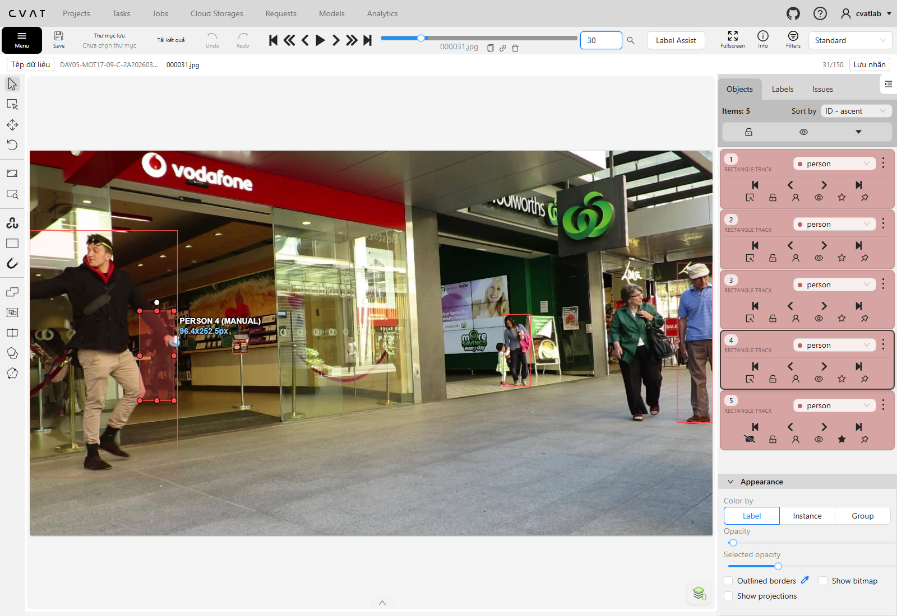
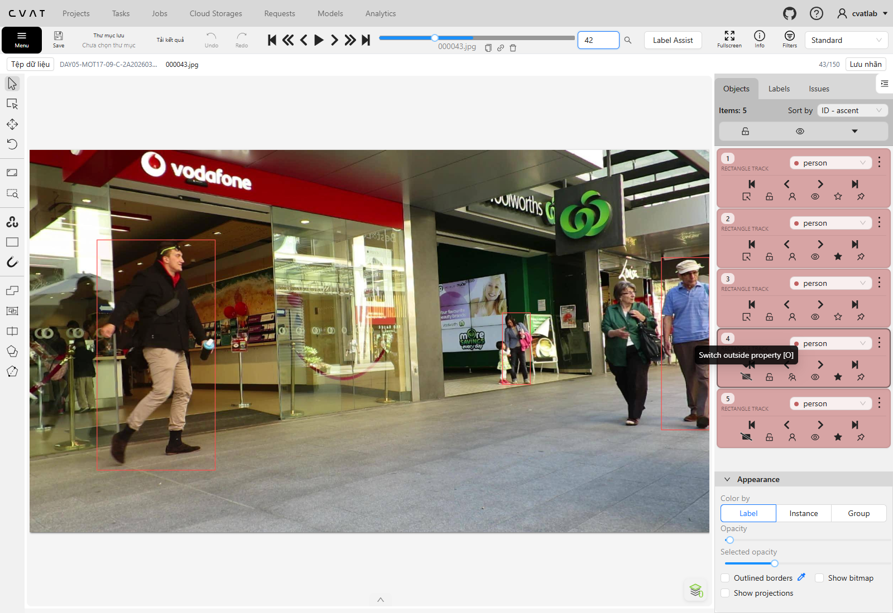
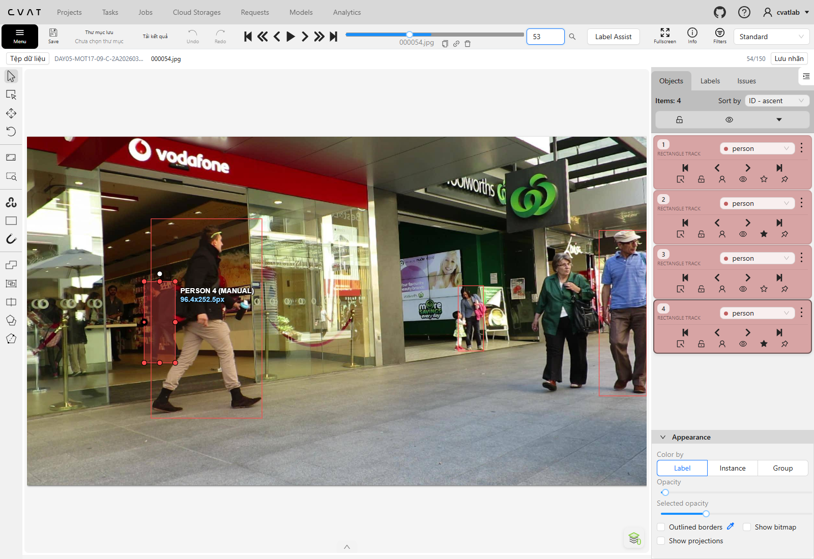

# Báo cáo cá nhân — Trương Tuấn Vũ — 2A202603078

Đoạn video: MOT17-09, 150 frame (frame CVAT 0–149), nguồn MOTChallenge, giấy phép CC BY-NC-SA 3.0.

## 0. Thông tin học viên

- Họ tên: Trương Tuấn Vũ
- MSSV: 2A202603078
- Mã đề (A/B/C): C
- Email: tvu562005@gmail.com
- Link repository: https://github.com/Iamfish00/K5-L2-DAY05-TruongTuanVu-2A202603078-MOTTracking.git
- Giờ bắt đầu: 16h40
- Giờ kết thúc: 18h10

## 1. Xem trước đoạn video (CP0)

Ghi **trước khi vẽ**, mỗi người một dòng.

| Mã | Frame xuất hiện | Frame cuối thấy được | Rẽ / dừng / đổi tốc độ ở frame | Bị che ở frame | Ghi chú |
|---|---:|---:|---|---|---|
| P1 | 0 | 106 | Không ghi nhận | 106 | |
| P2 | 0 | 135 | Không ghi nhận | 123, 136 | |
| P3 | 0 | 150 | Không ghi nhận | 41 | |
| P4 | 16 | 150 | Không ghi nhận | Không ghi nhận | |
| P5 | 62 | 150 | Không ghi nhận | Không ghi nhận | |

## 2. Keyframe và thời gian (CP1, CP4)

Số keyframe lấy từ kết quả `src/check_submission.py`.

| Mã | Số keyframe | Keyframe ở frame | Số frame có mặt | Keyframe / 100 frame | Thời gian (phút) | Chỗ khó |
|---|---|---|---|---|---|---|
| P1 | 25 | 0, 3, 8, 13, 21, 22, 31, 34, 50, 52, 53, 56, 58, 61, 64, 68, 71, 88, 93, 97, 106, 119, 126, 134, 145 | 142 | 17,6 |  | Bị che một phần từ frame 31 và mất box ở 42–49. |
| P2 | 16 | 62, 65, 69, 74, 79, 82, 86, 89, 96, 99, 103, 107, 112, 118, 125, 130 | 88 | 18,2 |  |  |
| P3 | 41 | 16, 18, 22, 24, 28, 31, 33, 34, 39, 46, 48, 57, 61, 63, 66, 69, 70, 76, 78, 80, 86, 90, 93, 94, 97, 99, 101, 103, 107, 113, 116, 117, 120, 121, 125, 128, 129, 136, 142, 145, 147 | 134 | 30,6 |  |  |
| P4 | 17 | 0, 3, 5, 8, 9, 12, 14, 16, 18, 19, 29, 31, 35, 36, 61, 93, 95 | 105 | 16,2 |  | Bị che một phần từ frame 95 và mất box ở 105. |
| P5 | 71 | 0, 1, 3, 6, 10, 13, 15, 16, 18, 20, 22, 24, 25, 26, 27, 28, 29, 31, 33, 36, 37, 38, 39, 40, 41, 42, 43, 44, 45, 47, 48, 49, 50, 51, 52, 53, 54, 55, 56, 57, 58, 59, 60, 61, 62, 64, 66, 68, 71, 73, 76, 77, 81, 84, 85, 88, 91, 93, 97, 100, 103, 110, 115, 117, 120, 126, 127, 129, 131, 133, 135 | 149 | 47,7 |  | Bị che ở frame 117, mất box ở 119 và hiện lại ở 120. |
| **Tổng** | **170** | | **618** | **27,5** | | |

Keyframe / 100 frame của cả bài = tổng keyframe ÷ tổng số frame có mặt × 100 = **27,5** (170 ÷ 618 × 100)

Bạn đặt keyframe nhiều nhất ở người nào? Vì sao (người đó rẽ, dừng, lại gần camera hay bị che)?

P5 có nhiều keyframe nhất (71). Các keyframe quanh frame 117–129 bám theo thay đổi vị trí khi P5 bị che, mất khỏi tầm nhìn rồi hiện lại.

## 3. Đoạn bị che (CP2)

Người bị che: `P1`

| Mốc | Frame |
|---|---:|
| Bắt đầu bị che một phần (bật `occluded`) | 31 |
| Mất hẳn (bật `outside`) | 42 |
| Hiện lại (tắt `outside`) | 50 |
| Thấy rõ trở lại (tắt `occluded`) | 53 |

- Thời gian khuất hẳn: 8 frame = 0,267 giây.
- Quyết định: giữ cùng ID (ID MOT 3).
- Lý do (trả lời 3 câu: khuất bao lâu so với 60 frame, ngoại hình có khớp, chỗ hiện lại có đúng hướng và tốc độ):

P1 khuất 8 frame theo nhãn, dưới ngưỡng 60 frame. Trước và sau đoạn che, P1 mặc áo tối màu và ở cạnh quầy. Box tiếp tục dịch sang phải sau khi P1 hiện lại. Tốc độ trong đoạn khuất chưa xác định.

Ảnh chụp màn hình:





## 4. Tự review ID (CP3)

đã kiểm hai lượt, không lỗi

Loại lỗi dùng đúng một trong 7 mã: `id_switch`, `fragmentation`, `lost`, `merge`, `false_track`, `drift`, `flag`.

| Frame | Mã người | Loại lỗi | Mô tả một câu | Phát hiện ở lượt | Đã sửa? |
|---:|---|---|---|---|---|
| | | | | | |
| | | | | | |
| | | | | | |

Tổng hợp số lỗi theo loại:

| `id_switch` | `fragmentation` | `lost` | `merge` | `false_track` | `drift` | `flag` |
|---:|---:|---:|---:|---:|---:|---:|
| | | | | | | |

Lỗi nào chỉ lượt 2 (theo cảnh) mới thấy, lượt 1 (theo người) không thấy? Vì sao?

...

## 5. File xuất và kết quả tự kiểm (CP4)

| Kiểm tra | Kết quả |
|---|---|
| Tên file MOT 1.1 | `TruongTuanVu_mot.zip` |
| Tên file CVAT for video 1.1 | `TruongTuanVu_cvat_video.zip` |
| Số track ID khác nhau trong `gt/gt.txt` (phải là 5) | 5 |
| Frame `outside` không có dòng trong `gt.txt` (đúng / sai) | Đúng |
| Job đã completed trên CVAT máy cá nhân | Có (job #8) |

Dán phần tóm tắt in ra từ `src/check_submission.py`:

```text
=== Tóm tắt ===
  Lỗi: 0   |   Cảnh báo: 0
  Đạt. Dán phần tóm tắt này vào báo cáo mục 5.
```

## 6. Ba câu kết

1. Nếu được gán lại, bạn sẽ đặt keyframe khác ở đâu? Vì sao?

   ở gần đó , vì hơi lệch đối tượng

2. Có chỗ nào bạn không chắc "cùng ID hay ID mới"? Bạn đã quyết định và ghi chú thế nào?

   không có

3. Một lỗi ID trong job của bạn (nếu không còn sót, chọn lỗi đã sửa) có thể làm xe tự lái dự đoán sai chuyển động của người đó như thế nào? Lỗi đó ảnh hưởng MOTA hay IDF1 nhiều hơn?

   không có 

## Bonus (nếu làm)

### B1 — Hai người đi sát

...

### B2 — So cách đặt keyframe

| Cách đặt | Số keyframe | Frame trôi nhất | Ghi chú |
|---|---:|---:|---|
| Đều mỗi 30 frame | | | |
| Theo chỗ đổi hướng | | | |

...

### B3 — So với tracker có sẵn

| Frame | Mã người | Tracker làm gì | Nhãn của bạn | Giải thích (đoán rồi sửa / ghép IoU / box score thấp / ngoại hình) |
|---:|---|---|---|---|
| | | | | |
| | | | | |

## 7. Tài liệu tham khảo và công cụ AI đã dùng


